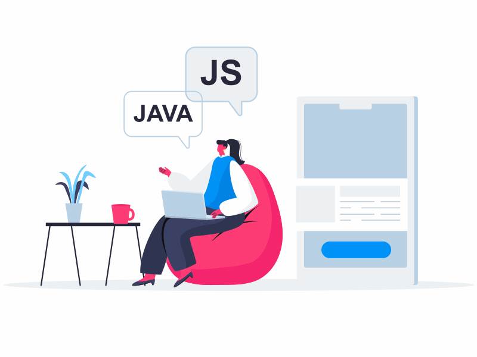

<!-- ═══════════════ ANIMATED HEADER ═══════════════ -->
<p align="center">
  
</p>

<p align="center">
  <a href="https://git.io/typing-svg">
    
  </a>
</p>

<p align="center">
  
  
  
</p>

<p align="center">
  <a href="https://sujeet597.github.io/my-portfolio/"></a>
  <a href="https://www.linkedin.com/in/sujeet-kushwaha-524113207"></a>
  <a href="mailto:sujeet.mitmeerut@gmail.com"></a>
  <a href="https://twitter.com/m__sujeet"></a>
  <a href="https://instagram.com/m_sujeet__"></a>
  <a href="https://www.hackerrank.com/m_sujeet"></a>
  <a href="https://codepen.io/Sujeet597"></a>
</p>


##  About Me

<table>
<tr>
<td width="58%" valign="top">

```python
class SujeetKushwaha:
    def __init__(self):
        self.role      = "Python Backend Developer & GenAI Engineer"
        self.building  = ["AI-powered SaaS", "LLM Apps", "RAG Pipelines"]
        self.stack     = ["Python", "Django", "FastAPI", "LangChain", "OpenAI"]
        self.exploring = ["MCP", "Multi-Agent Systems", "AI Automation"]
        self.ask_me    = ["RAG", "Vector DBs", "Django REST", "AI Agents"]
        self.email     = "sujeet.mitmeerut@gmail.com"

    def motto(self):
        return "Building intelligent software that scales 🚀"
```

</td>
<td width="42%" align="center" valign="middle">
  
</td>
</tr>
</table>


##  Tech Stack

<p align="center"><b>💻 Languages</b></p>
<p align="center">
  
</p>

<p align="center"><b>⚙️ Backend & Frameworks</b></p>
<p align="center">
  
</p>

<p align="center"><b>🤖 Generative AI</b></p>
<p align="center">
  
  
  
  
  
  
  
  
</p>

<p align="center"><b>🧬 Vector Databases</b></p>
<p align="center">
  
  
  
  
</p>

<p align="center"><b>🗄️ Databases &nbsp;•&nbsp; ☁️ DevOps & Tools</b></p>
<p align="center">
  
</p>


##  Featured Projects

<p align="center">
  <a href="https://github.com/Sujeet597/Agentic-company"></a>
  <a href="https://github.com/Sujeet597/ai-agent-food-ditecian"></a>
  <a href="https://github.com/Sujeet597/AI-TRIP-PLANNER"></a>
  <a href="https://github.com/Sujeet597/credit-card-fraud-detection"></a>
</p>


##  GitHub Analytics

<p align="center">
  
  
</p>

<p align="center">
  
</p>

<p align="center">
  
</p>

<!-- 🐍 Snake animation — generated by .github/workflows/snake.yml -->
<p align="center">
  <picture>
    <source media="(prefers-color-scheme: dark)" srcset="https://raw.githubusercontent.com/Sujeet597/Sujeet597/output/github-snake-dark.svg" />
    <source media="(prefers-color-scheme: light)" srcset="https://raw.githubusercontent.com/Sujeet597/Sujeet597/output/github-snake.svg" />
    
  </picture>
</p>


<p align="center">
  
</p>

<p align="center">
  
</p>
